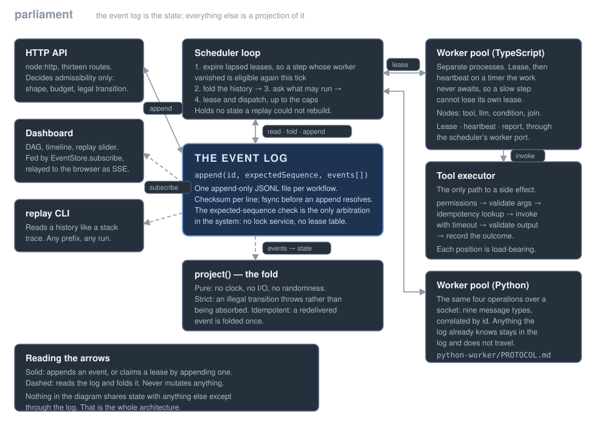

# 🏛️ Parliament

*A durable orchestration engine for agent workflows, built on one idea — the event log **is** the state — and a benchmark suite that found the engine's worst bug.*



Parliament is a workflow control plane in **23,137 lines of TypeScript and 1,459 lines of Python**, with **350 tests** — 329 TypeScript and 21 Python. It does durable multi-step DAGs, worker leasing with recovery from a `kill -9`, retry policies with backoff, idempotent tool execution, human approval gates, per-tenant cost budgets, a sandboxed tool runner, an HTTP API with Server-Sent Events, and a dependency-free dashboard with a replay slider. Zero runtime dependencies outside each language's standard library — the HTTP server, the JSON handling, the SVG DAG layout and the Python worker's protocol client are all written here.

**The benchmarks found a bug that 323 passing tests did not**, and it was the worst defect in the system:

Concurrent appends to *different* workflows raced on a shared index temp file. Two appends wrote `index.json.tmp`, interleaved bytes, and both renamed it — the second failing with `ENOENT`. Measured at **216 of 240 appends rejected** under 12 concurrent writers. But the lost write is not the harm. The rejection surfaces *after* the event's own `fsync`, so the caller is told its append failed **for an event that is already durable** — and `LeaseManager.acquire` catches only `ConcurrencyError`, so this propagated as a lease recorded in the log and believed lost by the worker holding it. That is precisely the state the whole leasing mechanism exists to prevent. After the fix: 0 rejections.

Three more defects came from the same exercise, each in a seam no single-component test covered:

- **A heartbeat was folded as a duplicate.** Renewal emitted a second `step.leased`, which the projection deduplicates on `(type, step, attempt, worker)` — so `leaseExpiresAt` kept the *original* expiry and `readySteps` would offer a step a worker was actively heartbeating on. The scheduler was unaffected because it reads raw events; everything reading the projection saw a live lease as lapsed.
- **The idempotency key was not injective.** `stepRefKey` joined fields with `/` without escaping, so two distinct steps could produce the same key — and that key is what deduplicates tool calls with side effects.
- **The definition lived only in memory**, which quietly falsified the project's central claim. The fold consults the retry policy to decide whether a `step.failed` becomes `failed` or `retrying`, so a restart replayed the same events into a *different* workflow. The definition is now recorded in `workflow.created`.

## ✨ Why I Built It

An agent pipeline is a distributed system wearing a trench coat. The moment a step calls a model, charges a card, or waits for a human, the interesting questions stop being about prompts: what happens when the process holding that step dies? When a tool succeeds but the response is lost? When the same request arrives twice?

The orthodox answer is a state machine in a database, and it has a failure mode I wanted to avoid. A mutated row tells you where a workflow *is* and nothing about how it got there, so "why did this end up here" is answered by inference. Event sourcing inverts that: state is a fold over an append-only log. Three things then fall out rather than being built — crash recovery is a replay with nothing to reconcile, debugging is reading, and duplicate tolerance is detectable because events carry identity.

The cost is real and I did not discover it gracefully: the log is a compatibility surface forever, and the fold is linear in history length with nothing bounding it. Both are measured below.

## 🔭 What It Does

**Durable workflows.** A DAG of tool, model, approval and join steps. State is projected from the log, never stored. Illegal transitions throw rather than being absorbed.

**Leasing, not ownership.** A lease is time-bounded permission to work on a step. Ownership would have to be revoked, and revoking something held by a process that stopped answering is not possible. A lease simply lapses. The consequence is paid deliberately: a step can run twice, so handlers must be idempotent — the alternative is a workflow that stalls forever the first time a worker is killed.

**Lease expiry is not failure.** `step.lease_expired` is its own event and does **not** consume a retry attempt. The attempt counter tracks faults of the work, not of the worker holding it. Conflating them lets a scheduler report a workflow failed while the original attempt is still running somewhere.

**Mutual exclusion without a lock.** Optimistic concurrency on the log and nothing else. An in-process mutex would work right until a second scheduler process started, then fail silently and intermittently.

**Idempotent tools.** Keys derived from `(workflowId, step, attempt)`, with recorded outcomes shared across workers so a repeat returns the memoized result instead of repeating the side effect.

**Approval gates.** The *step* waits; the workflow does not. An earlier design had the workflow wait too, which is wrong whenever the graph has parallel branches — one pending approval would stall work with nothing to do with it.

**Observability.** An HTTP API, SSE change feed, a hand-rolled SVG DAG view with a replay slider, a `timeline()` debugging view, Prometheus metrics, and a `replay` CLI that renders any history as an annotated trace.

## 🧱 How I Built It

TypeScript for the control plane, Python for a worker tier that talks over a documented wire protocol — no shared types, no generated code, so the boundary is a contract rather than a build artifact.

The load-bearing decision is that `EventStore.append` takes the sequence the caller believes the log is at. Passing the wrong one is a conflict, not an overwrite. That single mechanism replaces a distributed lock: two schedulers both deciding a step is ready both try to append a lease, and exactly one wins.

Two contract decisions came out of failures rather than design. `EventStore.subscribe` is on the interface rather than in a decorator, because a wrapper means anything constructed with the *unwrapped* store silently stops feeding live views — the scheduler keeps working, the log keeps growing, every dashboard goes stale, and nothing errors. And `StepFailed.willRetry` is recorded in the event rather than re-derived, because a fold that consults the current retry policy is not a function of the log alone: replaying an old history against a changed policy would produce different states, and the determinism everything rests on would quietly not hold.

## 📊 What the Measurements Say

Full detail in [`bench/results.md`](bench/results.md), which is **generated by `npm run bench`** — a stale results file is impossible. Hardware is probed at runtime (Apple M4 Pro, 14 cores, 48 GB, Node v18.20.2, file store on SSD/apfs). Every figure is a median over 3–7 runs reported as `median (min–max, sd)`.

### The fold is linear, and that is the design's real limit

| events | fold | ns/event |
|---|---|---|
| 100 | 0.034 ms | 342 |
| 1,000 | 0.366 ms | 366 |
| 10,000 | 3.74 ms | 374 |

Flat per-event cost, which is the honest answer: **linear, with no snapshotting to bound it.** The consequence is not abstract. The scheduler re-folds every active workflow every tick, so a step heartbeating for a day is ~17k events and **6.36 ms of CPU per tick** purely to re-derive state it derived on the previous tick. A few hundred such workflows and the tick loop is the bottleneck. Snapshotting is the fix and **it is not implemented.**

The fold is really O(events × nodes), so there is a second axis: 327 ns/event at 4 nodes, 434 at 16. And `timeline()` is quadratic, as its own comment admits — 1.89 ms at 100 events.

### Durability costs about 5,400×

| store | ms/append | appends/sec |
|---|---|---|
| memory | 0.002 | 485,351 |
| file (fsync) | 13.6 | 73.6 |

Batching amortizes it, because it is one fsync per *append* and not per event: 64 events per append reaches ~4,900 events/sec with appends/sec flat. Payload size is irrelevant across a 1,000× range (64 B → 64 KiB) — fsync dominates entirely.

### Contention: two things I expected and the data refuted

N schedulers racing for 24 steps, with every run asserting each step was leased **exactly once**:

| schedulers | conflict rate |
|---|---|
| 1 | 0% |
| 2 | 50% |
| 4 | 75% |
| 16 | 94% |

Exactly (N−1)/N, which is what it should be when arrivals are not independent — every scheduler sees the same ready set at the same instant.

I expected the file store to show a *different* rate, since fsync widens the window. It is **identical to the event**: the losers are synchronized by the same thing that creates them. I also expected wall time to collapse; it degrades only ~3.6× from N=1 to N=16. The report flags programmatically that the N=1/2/4 wall-clock ranges overlap and are not distinguishable — comparing them would be reading noise.

### Recovery is a replay, and it scales with workflow count

100k events across 50 active workflows: **101 ms** to read and fold, 108 ms total. `open` scales with workflow *count* rather than history length, because the index-valid path only `stat`s. With `index.json` deleted the degraded path is 7–27× slower — the price of "the index is a cache" being true rather than merely claimed.

### End-to-end latency is tick latency

A diamond DAG against the real scheduler: 78.0 ms at a 50 ms tick, 22.1 ms at a 1 ms tick, for 20–25 ms of critical-path work. Store time is under 0.2 ms. Nearly all the rest is waiting for the next tick.

The report names its own error here: an earlier version subtracted the *sum* of tool time rather than the critical path, producing a negative "unaccounted" column. That version was wrong and is called out rather than quietly corrected.

## 📚 What I Learned

**A seam is where bugs live, and no single-component test covers one.** The heartbeat bug needed the lease manager and the projection to disagree; each was correct alone. I only caught the last of it because I wrote a test that crossed the boundary and then mutation-tested it — changing the fix back made exactly one test fail, which is the proof the bug lived somewhere no unit test looked.

**Fixing a bug can trade it for a worse one.** Making renewals emit `step.lease_extended` fixed the duplicate fold and broke `currentLeaseOf`, which fell through to `default: break` — so renewals stopped extending the lease from the scheduler's own view either. The fix was incomplete until the fold handled the new event *and* guarded on holder identity, because a worker whose lease lapsed may still have a heartbeat in flight.

**"The log is the state" is a claim you have to keep.** It was false for most of this project's life, because the fold needs the definition and the definition lived in a `Map`. Nothing failed; a restart just silently reconstructed a different workflow, and `synthesizeDefinition` made the degradation survivable enough to hide it.

**A benchmark is a test with better reach.** Every one of the four real defects was found by measurement or by a demo, not by the suite. The 323 tests that existed before the benchmarks ran all passed, including the ones specifically about leasing and the file store.

**A demo step that cannot fail proves nothing.** The idempotency phase was vacuous until it ran the same crash twice — once with recorded outcomes shared across workers and once isolated — and showed the side effect happening 1 time versus 2. Same step, same attempt, same key. Without that A/B the step printed "succeeded" either way.

**Report what the data cannot distinguish.** The most useful line in the contention table is the note that three of its rows overlap within their ranges. A benchmark that presents indistinguishable numbers as a trend is worse than one that admits the limit.

## ⚖️ What I Do Not Claim

**This is not Temporal, Airflow, or Step Functions.** No snapshotting, so the fold is unbounded. No distributed coordination beyond optimistic concurrency on a single store — the file store assigns sequences from an in-memory index, so exactly one process may write a given log. No multi-region anything. No durable timers surviving a control-plane restart mid-backoff.

**The fold being linear is a real ceiling, not a footnote.** Measured above: a few hundred long-lived workflows and the tick loop saturates. The fix is well understood and absent.

**Exactly-once is not on offer.** A lease can lapse while its holder is alive and merely partitioned, so a step can run twice. Every handler must be idempotent; the engine provides keys and memoized outcomes to make that practical, and nothing more. Anything claiming exactly-once over a network is wrong.

**`timeline()` is quadratic** and is a debugging view, not a production endpoint.

**The sandbox bounds wall-clock time and the filesystem root, and nothing else.** It is not a security boundary against hostile code. It stops a runaway tool, which is what it was built for.

**The dashboard is dependency-free, which means hand-rolled.** The DAG layout is a layered sort, not a graph-drawing algorithm; it will look worse than Graphviz on a wide fan-out. State is carried by glyph *and* colour rather than colour alone, which was deliberate.

**The cost model is an estimate.** Token counts on the estimated path divide characters by four, and that path is marked `estimated` so the dashboard can say so rather than presenting a guess as a measurement.

## 🛠️ Tech Stack

- **TypeScript** (Node 18+) — control plane, HTTP API, scheduler, workers, CLI, dashboard. No runtime dependencies.
- **Python 3** — worker tier over a documented wire protocol. Standard library only.
- **Vitest** for tests, `tsx` to run without a build step.
- Hand-written: HTTP routing, SSE, SVG DAG layout, event store (memory + file with torn-tail recovery), sandboxed tool runner.

## 🚀 Setup

```bash
npm install          # devDependencies only: typescript, tsx, vitest, @types/node
npm test             # 329 tests
python3 -m unittest discover -s python-worker/tests   # 21 tests
npm run typecheck    # both tsconfigs, including bench/ and scripts/
```

The demo is the fastest way to understand the project — 17 proofs in about 30 seconds, including a worker killed with `SIGKILL` mid-step and recovered by another, and a control plane killed mid-step whose restart folds to a byte-identical projection:

```bash
npm run demo
```

Benchmarks, which regenerate `bench/results.md`:

```bash
npm run bench
```

The server and dashboard (`serve` builds the dashboard first, because a fresh clone has no `dist/` and a blank page with a console 404 looks like a broken project):

```bash
npm run serve:demo   # seeded with a demo workflow, dashboard at http://localhost:8080
```

Replay any workflow as an annotated trace:

```bash
npm run replay -- --demo              # a seeded history
npm run replay -- wf_abc123 --at 12   # a live one, as of sequence 12
```

## 🗺️ Repository Map

```
src/events/        The log: types, memory store, file store with torn-tail recovery
src/workflow/      Definitions, validation, step references, retry policy
src/state/         project(), readySteps(), replayTo(), timeline()
src/scheduler/     Leasing, retries, approvals, the tick loop, history folds
src/workers/       Worker runtime, heartbeating, graceful release
src/tools/         Tool registry, idempotency keys, recorded outcomes, sandbox
src/policy/        Per-tenant cost budgets and limits
src/api/           HTTP API, SSE change feed, metrics, trace view
src/cli/           replay — renders a history as an annotated trace
dashboard/src/     DAG view, timeline, approvals, replay slider. No framework.
python-worker/     Python worker tier + PROTOCOL.md
bench/             Benchmarks; results.md is generated, never hand-edited
scripts/demo.sh    17 proofs, each with a before/after that genuinely differs
docs/img/          Architecture and event-flow diagrams, hand-written SVG
```

## 📄 License

MIT
